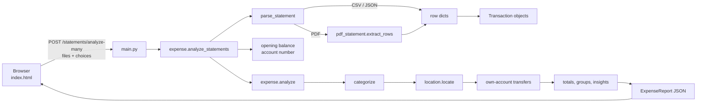

# Architecture

## Folder layout

```
expense-copilot/
├── app/                      # the application
│   ├── main.py               # FastAPI app: HTTP endpoints, serves the page
│   ├── expense.py            # parsing rows, categorizing, analysis pipeline, report
│   ├── pdf_statement.py      # reading transactions out of PDF statements
│   ├── own_accounts.py       # recognising the user's own accounts and name
│   ├── location.py           # finding places in transaction descriptions
│   ├── models.py             # Pydantic data models (Transaction, ExpenseReport, …)
│   ├── data/places.csv       # built-in list of cities, towns and villages (editable)
│   └── static/index.html     # the whole front end: HTML, CSS and JavaScript
├── tests/                    # pytest test suite
├── samples/                  # fake statements in every supported format
├── scripts/make_samples.py   # regenerates the files in samples/
├── docs/                     # this documentation
├── .claude/launch.json       # dev-server definition for the Claude desktop app
├── requirements.txt
└── README.md                 # user guide
```

## How a request flows



1. The user picks statement files in the browser, names each account, and
   optionally enters their name, other account numbers and opening balances.
2. The browser sends everything as `multipart/form-data` to
   `POST /statements/analyze-many`.
3. `main.py` reads each upload into memory and calls `analyze_statements`.
4. Each file is parsed into `Transaction` objects. Identical files are skipped,
   and rows repeated across two statements of the same account are counted once.
5. `analyze` categorizes, locates and links transactions, then computes every
   total and grouping and returns one `ExpenseReport`.
6. The report goes back as JSON. The browser draws the tiles, charts and tables
   from it. Filters (account, category, location, date) are applied in the
   browser without another request.
7. When the user changes what to count (ticks a transaction, answers the
   large-transaction question), the browser re-sends the same files with the
   choices and redraws. The server keeps no state between requests.

## Modules

### `main.py` — HTTP layer
Thin on purpose: it turns form fields into Python arguments, calls
`analyze_statements`, and turns `StatementParseError` into an HTTP 422 with a
readable message. It also serves `static/index.html` at `/`.

### `expense.py` — parsing and analysis
* **`parse_statement(filename, content)`** picks a reader by file extension,
  then turns each row into a `Transaction` with `_row_to_transaction`. Column
  names are matched loosely (`date`/`txn_date`/`value_date`,
  `narration`/`particulars`, `debit`/`withdrawals`, …) so most bank exports work
  without configuration. Amounts accept `₹`, `$`, thousands separators and
  `(1,234.00)` negatives; balances accept `Cr`/`Dr` suffixes.
* **`analyze_statements(files, …)`** handles everything that spans files:
  duplicate detection, merging statements with the same account name,
  account-number and opening-balance detection, and stable transaction IDs.
* **`analyze(transactions, …)`** is the pipeline that produces the report (see
  below).

### `pdf_statement.py` — PDF reader
Turns a text-based PDF into the same row dictionaries a CSV produces, so the
rest of the app does not care where rows came from. See
[PDF reading](#pdf-reading).

### `own_accounts.py` — the user's own accounts
Holds the user's account numbers (typed or read from statement headers) and
name, and answers two questions: *does this narration mention another of my
accounts?* and *does it mention my name?*

### `location.py` — places
Finds the most specific place in a narration. See [Locations](#locations).

### `models.py` — data model
Pydantic models shared by the analysis code and the API. FastAPI uses them to
validate and serialize the response, and they generate the OpenAPI schema at
`/docs`.

### `static/index.html` — front end
One self-contained file: markup, styles (light and dark themes), and
JavaScript for uploading, filtering, charts, tables and dialogs. See
[Front end](#front-end).

## The analysis pipeline (`analyze`)

| Step | What happens |
|---|---|
| 1. Categorize | Each transaction gets a category from keyword rules: spending categories for debits (Rent, Groceries, Dining, Transport, Travel, Entertainment, Shopping, Bills & Utilities, Health, Fitness, Education, Farming, Cash withdrawal, Transfers, Other); income categories for credits (Salary, Interest, Refunds & cashback, Freelance & business, Transfers in, Other income). The first matching category wins, so order matters (Rent before Transfers). Keywords must start a word, so `ola` matches "OLA CABS" but not "COCA-COLA". |
| 2. Locate | `location.locate` attaches a place, if the narration names one. |
| 3. Own-account transfers | Moves between the user's own accounts are marked and later excluded (see [below](#own-account-transfers)). |
| 4. Order | All accounts are merged into one timeline sorted by date. The sort is stable, so same-day rows keep statement order. |
| 5. Count | "Counted" transactions are those that are neither own-account transfers nor left out by the user. Every total uses only these. |
| 6. Aggregate | Income, spending, net; spending and income by category; a summary per account (with opening and closing balance); spending by state and by city/town/village; opening balance, money available and money left. |
| 7. Insights | Short sentences: largest category, deficit, money carried over, transfers excluded, top location, and so on. |

## Key algorithms

### PDF reading
1. **Tables, by word position.** pdfplumber finds ruled tables and their
   rows. The header row is recognised by its words (Date, Narration,
   Withdrawal, Deposit, Balance, …), which gives each column's x-range. Every
   word in a row is assigned to the column it sits under. This matters because
   many banks only draw vertical lines. pdfplumber then sees the whole table
   body as one row, and the sparse Withdrawal/Deposit columns hold fewer values
   than there are dates, so values can't be matched by order. Splitting the row
   at each line that starts with a date, and assigning words by position,
   restores one transaction per date. Wrapped narration lines join the date
   above them.
2. **Plain text, as a fallback.** Lines that start with a date and end with
   amounts are read as transactions. Money in or out comes from a `Dr`/`Cr`
   marker, a minus sign, the change in running balance, or, as a last resort,
   words like "salary" or "refund".
3. **Clear failures.** Scanned PDFs with no text, password-protected PDFs and
   corrupt files each produce a specific message instead of a crash.

### Own-account transfers
A transaction is the user's own transfer only if its category is a plain
transfer (never salary, interest, refunds or shop payments) and its narration:
* mentions **another** of the user's accounts: masked (`XXXXXX1234`), labelled
  (`A/C 1234`), or the full number. A statement mentioning its *own* number is
  ignored, and a bare reference number that happens to end in the same 4
  digits is not matched;
* mentions the user's name as their bank prints it, together with a transfer
  word (UPI/NEFT/IMPS/RTGS); or
* says `SELF` / `OWN A/C`.

When both statements are uploaded, the debit is paired with the credit of the
same amount in another account within 3 days, and both rows say where the
money went. Each excluded row stores the reason in `transfer_note`.

### Opening balance (money carried over)
For each statement, in order of preference: the number the user typed; the
running balance (first row's balance minus its amount); or an "Opening Balance"
line in the PDF text. Newest-first statements are detected by checking which
row order makes every balance equal the previous balance plus the amount. For
several months of one account, the earliest month's opening is used. Then
money available = opening + income, and money left = money available − spending.
The closing balance per account (opening + every transaction) is shown so it
can be checked against the bank.

### Locations
The narration is upper-cased and split into words. Every phrase of 1–4 words
is looked up in an index built from `data/places.csv` (cities, towns, villages
and their aliases, like Bangalore → Bengaluru) plus all states and union
territories. The most specific match wins (village > town > city > state);
longer phrases win ties. Two-letter state codes are trusted only as the last
word of a POS narration, and codes that are also common words (UP, AS, AP, OR,
IN) are ignored. A PIN code written as `PIN 571401` gives the state by its
prefix. State names followed by "BANK"/"NATIONAL"/… are bank names, not
places. Users can add villages to the CSV or point `EXPENSE_COPILOT_PLACES` at
their own file.

### Stable transaction IDs
Each transaction gets `sha1(account, date, amount, description, n)[:12]`, where
`n` counts identical rows (two equal coffees on one day). The same files always
produce the same IDs, so the browser can send back "leave these out" or "count
these" and the server applies them on the next analysis without storing
anything.

## Data model (`models.py`)

| Model | Purpose | Notable fields |
|---|---|---|
| `Transaction` | One statement row after analysis | `id`, `date`, `description`, `amount` (negative = money out), `balance`, `category`, `account`, `location`, `internal_transfer` + `transfer_note`, `user_excluded`, `user_included` |
| `Location` | Where a transaction happened | `name`, `level` (state/city/town/village), `district`, `state`, `pincode` |
| `CategorySpend` | A category total | `category`, `amount`, `percentage`, `count` |
| `AccountSummary` | One account | `account`, masked `account_number`, period, income, spending, net, `opening_balance`, `closing_balance`, `top_category` |
| `LocationSpend` | A place total | `name`, `level`, `district`, `state`, `amount`, `percentage`, `count` |
| `ExpenseReport` | The whole response | totals, `category_spend`, `income_sources`, `accounts`, own-transfer totals, `opening_balance` / `money_available` / `left_at_end`, `state_spend` / `place_spend`, left-out totals, `insights`, `warnings`, `transactions` |

## HTTP API

Interactive documentation is generated automatically at
`http://127.0.0.1:8000/docs`.

| Method | Path | Purpose |
|---|---|---|
| GET | `/` | The web page |
| GET | `/health` | `{"status": "ok"}`, for checks |
| POST | `/statements/analyze` | One file in field `statement` → `ExpenseReport` |
| POST | `/statements/analyze-many` | Several files → one combined `ExpenseReport` |

`/statements/analyze-many` form fields (all repeatable fields line up by position):

| Field | Meaning |
|---|---|
| `statements` | The statement files (CSV, JSON or PDF), up to 20, 10 MB each |
| `labels` | Account name for each file; the same name merges statements |
| `account_numbers` | Account number for each file (last 4 digits are enough); read from the statement when blank |
| `opening_balances` | Opening balance for each file; worked out from the statement when blank |
| `owner_names` | Comma-separated, how banks print the user's name on transfers |
| `other_accounts` | Comma-separated numbers of the user's accounts with no statement uploaded |
| `excluded` | Transaction IDs to leave out of every total |
| `included` | Transaction IDs to count even though they look like own-account transfers |

Errors return HTTP 422 with `{"detail": "<readable message>"}`. Files that
can't be read are skipped and listed in `warnings`, so one bad file doesn't stop
the others.

## Front end

`static/index.html` is a single page with no framework and no build step.

* **State:** one `state` object holds the report, the selected files, the
  filters (account, category, location, date range, money in/out, sort
  order), the chart views, and the user's choices (`excludedIds`,
  `includedIds`).
* **Rendering:** each section has a `render…` function that rebuilds its HTML
  or SVG from `state`. Filters re-render in the browser; changing what to
  count re-requests the report (debounced, so several clicks become one
  request) while keeping filters and scroll position.
* **Charts:** small functions draw inline SVG: horizontal bars (categories,
  locations, sorted spending days), paired bars (accounts), stacked columns
  (spending by date, with ▲ income markers), and a line chart (cumulative).
  All have hover tooltips; most are clickable filters. They redraw when their
  container is resized (`ResizeObserver`).
* **Colours:** CSS custom properties with light and dark values. Category
  colours come from a fixed, colour-blind-checked palette and stay attached to
  a category when filters change. Blue is reserved for income, orange for
  spending, and green/red only for surplus/deficit.
* **Dialogs:** the large-transaction review (over ₹50,000, `LARGE_AMOUNT`)
  uses the native `<dialog>` element.
* **Remembered in the browser:** only the user's name and other account
  numbers, in `localStorage`, for convenience. Statements are never stored.

## Privacy and safety

* No persistence: uploads are read into memory, parsed, and dropped when the
  request ends. There is no database, log of statement contents, or cache.
* No outbound network calls from the server; the page loads no third-party
  scripts, fonts or styles.
* Limits: 10 MB per file, 20 files per request, 200 PDF pages.
* All text from statements is HTML-escaped before it is shown.
* The server listens on `127.0.0.1` by default, so other machines can't reach
  it.

## Known limitations

* Scanned (image-only) PDFs need OCR, which isn't supported; export CSV instead.
* Categories and locations come from keyword lists; unusual merchants fall
  into "Other", and online payments usually have no location.
* Own-account transfers need a clue (an account number, the user's name, or
  "SELF") in at least one narration.
* User choices about what to count last until the page is reloaded.
